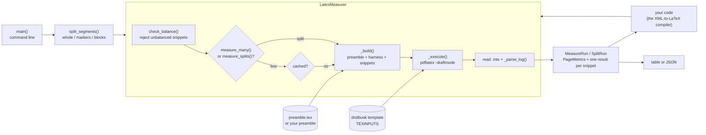
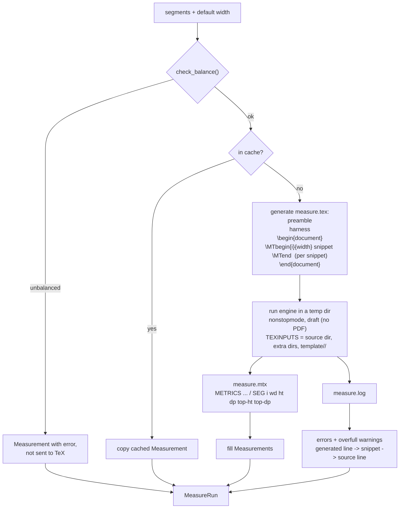
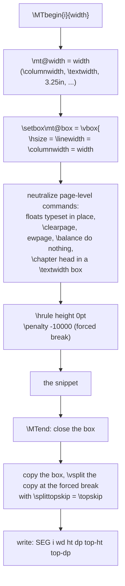
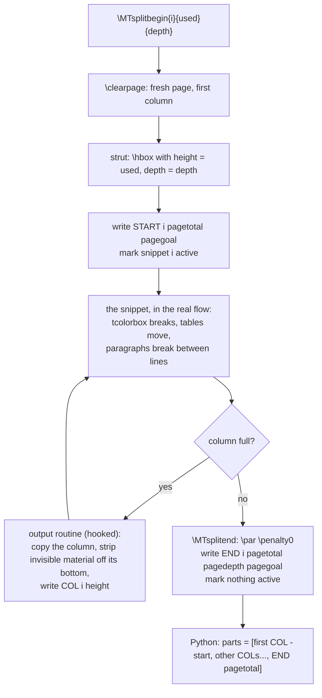
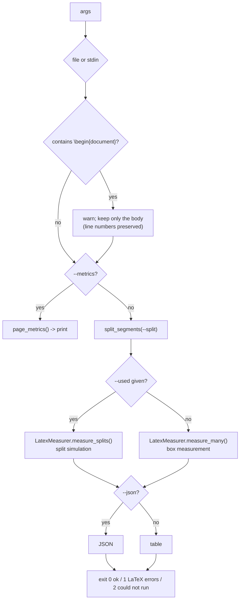

# latex_measure: design

[Back to README](README.md)

## The idea

Don't predict how big a block will be: let TeX typeset it and read the size back. The block is typeset into a box under the real preamble, at the real column width, and TeX writes the box's width, height and depth to a file. Python reads that file. Because the same engine, fonts, class and macros produce the numbers, they match the final document.

Everything lives in one module, `latex_measure/core.py`, plus the default preamble `latex_measure/preamble.tex`. `__init__.py` re-exports the public API, `__main__.py` makes `python -m latex_measure` work, and `pyproject.toml` installs the `latex-measure` command (it calls `core.main()`).

## Architecture

| Piece | Job |
|---|---|
| `split_segments()` | Turns a body file into `Segment`s: the whole file, one per `% measure:` marker, or one per top-level block |
| `check_balance()` | Rejects a snippet whose braces or environments don't balance, before TeX sees it |
| `LatexMeasurer` | Holds the preamble, template path and engine; caches box results; runs TeX once per batch. `measure`/`measure_many` measure boxes, `measure_split`/`measure_splits` run the split simulation |
| `_execute()` | Shared by both modes: builds the document, runs the engine, sorts output, errors and warnings by snippet |
| `TEX_HARNESS` | The TeX macros inserted between the preamble and `\begin{document}`: `\MTbegin`/`\MTend` (box), `\MTsplitbegin`/`\MTsplitend` plus an output-routine hook (split), `\MTmetrics` |
| `_parse_log()` | Pulls errors and overfull-box warnings out of the log and maps them back to snippets and source lines |
| `Measurement`, `SplitMeasurement`, `PageMetrics`, `MeasureRun`, `SplitRun` | Plain dataclasses for the results |

## One measurement run

All snippets go into **one document and one engine run**. Starting pdflatex and loading dndbook takes about a second; each extra snippet costs a few milliseconds. The 115 blocks of `adventure_text.tex` measure in about 1.3 s.

The engine runs in `nonstopmode`, so an error in one snippet doesn't stop the others. Each snippet records the lines it occupies in the generated file; the `l.<n>` line of each log error says which snippet it belongs to and where in the source file. The log is kept unwrapped (`max_print_line`) so messages parse cleanly.

Results go to a separate file (`\jobname.mtx`, via `\newwrite`) rather than the log, so they can't be broken by log line-wrapping or mixed up with package chatter.

## Inside TeX: measuring one snippet

### Why a `\vbox` with `\hsize`, not a `minipage`

The obvious approach is `\begin{minipage}{3.25in} ... \end{minipage}`. A minipage changes the typesetting it's meant to measure: it sets `\parindent` and `\parskip` to zero, resets list and footnote handling, and suppresses the space above the first paragraph. A plain `\vbox` with `\hsize`, `\linewidth` and `\columnwidth` set to the target width typesets the content exactly as it is in a column of the real document. Setting `\columnwidth` too matters because dndbook's boxes (tcolorbox sidebars, `DndTable`'s `tabularx`) size themselves from `\linewidth`/`\columnwidth`.

### Two heights: running text and top of column

The same content takes different space depending on where it lands:

- **In running text**, space a block asks for above itself (a `\section`'s before-skip, `DndTable`'s `\vspace{9pt}`) is real space. That's `height_pt`, the box's plain height.
- **At the top of a column**, TeX throws away discardable items (glue, kerns, penalties) at the top and inserts `\topskip` so the first baseline sits at a fixed place.

To get the second number without typesetting twice, the harness starts the box with a zero-height rule and a forced break (`\penalty-10000`), then `\vsplit`s a copy of the box at that break. `\vsplit` treats the remainder exactly like the start of a new page: it prunes the discardable items at the top and inserts `\splittopskip`, set to `\topskip`. The remainder's height is `top_height_pt`. This was checked against `\pagetotal` in a real two-column dndbook document: the numbers are identical.

### Floats and page-level commands

A float can't be put inside a box (`Not in outer par mode`), and many dndbook features float: `figure`, `table`, `figure*` (via `stfloats`), and `DndSidebar[float=!b]` (tcolorbox calls `\@float` itself). Inside a measurement box, `\@float` and `\@dblfloat` are redefined to typeset the float body in place, in a `\vbox` of `\columnwidth` or `\textwidth`, with the usual float setup (`\@floatboxreset`, `\@captype` for captions). The measurement is the float's own box; the separation TeX adds when it places the float (`\textfloatsep`) is in `PageMetrics`.

`\chapter` in a two-column dndbook uses `\@topnewpage` to set the head across both columns and start a new page. Inside the box, `\@topnewpage` just typesets the head in a `\textwidth` box, so it's measured at the width it really uses. `\clearpage`, `\cleardoublepage`, `\newpage` and `\balance` are made to do nothing.

These redefinitions are local to the measurement box, so the preamble's own definitions are untouched.

## Split simulation

A box can say how tall a block is, but not how TeX breaks it, because breaking only happens on the real page. So the split simulation doesn't use a box at all. Each snippet is typeset in the normal page flow on a fresh page, after a strut that stands in for the content already in the column, and TeX's own output routine reports what went into each column.

**The strut.** Its height is the space already used; its depth is the depth of the last line before the block. TeX sets the space between two lines from the first one's depth (`\baselineskip` minus the depth and the next height), so with the right depth the block starts exactly where it would after real text. This was checked against real preceding paragraphs for the Ancient Gold Dragon: with the depth, 10 of 10 cases broke at the same line and ended at the same height; without it, 9 of 10.

**The output-routine hook.** At `\begin{document}` the harness prepends `\mt@colrec` to LaTeX's `\output`. Each time TeX ships a column while a snippet is active (LaTeX's internal output calls, `\outputpenalty < -10000`, are skipped), it copies `\box255`, re-boxes it at natural height and writes the height. Before measuring, it strips glue, kerns, penalties and empty boxes off the bottom (`\lastnodetype`), so only visible material counts. Without that, a stat block that moved whole to the next column still showed a 12pt "first piece": its own before-space left behind in the old column.

**The parts.** The first column's height minus the strut is the block's first part. Full columns in between are parts as they are. The `\pagetotal` at `\MTsplitend` is the last part (unless the block ended exactly at a column break, when the page is empty: `\pagegoal` is `\maxdimen`). `\MTsplitend` adds `\penalty0` first so the space the block leaves after itself is on the page: `end_pt` is where the next block would start.

Floats aren't in the column box (TeX keeps them in its float areas), and `\chapter` heads in two-column mode are set above both columns by the output routine, so neither counts as part of the block. A chapter head still shortens the columns under it, so a chapter and the content after it, measured as one segment, flow exactly as in the document.

## CLI flow

## Known limits

- **Separate boxes don't add up exactly.** Two blocks measured separately leave out the interline glue and `\parskip` TeX puts between them. Measure them as one segment when the combined height matters.
- **Shrink isn't reported.** Boxes are measured at the natural size of their glue. TeX's page builder can shrink glue to fit a little more into a column, so natural sizes are slightly conservative. pdfTeX has no way to read a box's total shrink back.
- **The split simulation models what's before the block as a strut.** That matches real preceding text exactly when you pass its height and depth. It doesn't model floats waiting to be placed, or a page whose columns a `figure*` has already shortened: each snippet starts on a clean page.
- **Split parts are natural heights.** If TeX squeezed flexible space to make a piece fit, the reported part can be slightly larger than the space that was left.
- **Inside a box, a breakable tcolorbox is typeset unbroken.** That's the right size for any stat block that fits a column. For one taller than `\textheight`, tcolorbox sizes the box through its own oversized-box path (it `\vsplit`s at `\textheight`), so its unbroken height can differ from the measurement by a few points. Such a block always splits in the real document anyway.
- **Snippets that change global state** (counters, `\setcounter`, `\label`) do so for the snippets after them in the same run. A section number going from 9 to 10 can change a width slightly.
